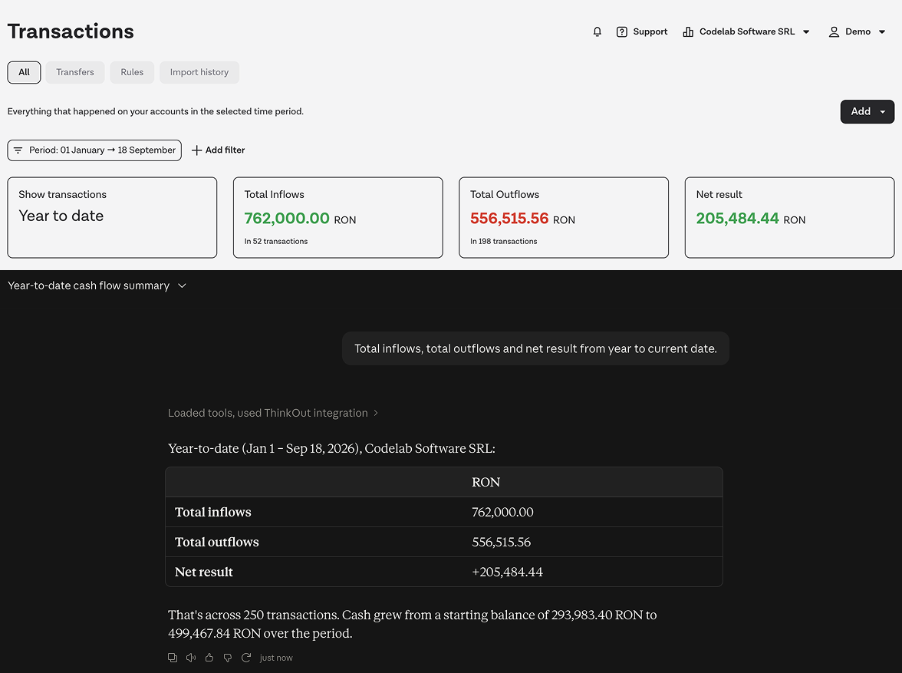

## Where the numbers come from

Every result is computed by ThinkOut, with the same rules as the cash flow
screen:

- transfers between your own accounts are excluded
- movements you excluded are left out
- split payments are counted once
- foreign currency transactions are converted at the rate on the movement date

You can check at any time that the results in the conversation and the ones
ThinkOut gives you directly in the app match.

The assistant works from the data in your transactions, forecasts, budgets,
scenarios and bank accounts. For now it does not see invoices, contracts, headcount or payment terms, so a
question that depends on that kind of information (for example "how many days
pass from invoice to payment" or "what does an employee cost me") needs details
that only you can supply. Questions about projects and profitability will be as
relevant as your classification in ThinkOut is accurate.

## What your assistant can do

Behind the conversation, the assistant can ask ThinkOut:

| It can | Which lets you ask |
| --- | --- |
| List the workspaces you have access to | "Which companies do I have here?" |
| Read your setup — banks, accounts, categories, labels, counterparties | Questions by name: "the BT accounts", "marketing", "uncategorised transactions" |
| Look up several names at once | Typos and missing diacritics resolve anyway |
| Read daily account balances | Balances on any date, by bank, by currency |
| Read transactions aggregated over a period, with one grouping | Totals, trends, rankings, comparisons |
| List individual transactions, fifty at a time | The transactions behind an aggregated result |
| Report how often each category, label or counterparty is used | "What categories do I have?", "Who are my top three clients?" |
| List your categorisation rules | "Why did this land in that category?" |
| Read transfers and excluded transactions | "What moved between my own accounts?" |
| Read forecasts aggregated over a period, with one grouping | "What do we expect to come in next month, and from whom?" |
| List individual forecasts, fifty at a time, by status | "Which planned payments are overdue?" |
| Read cash flow, what has happened and what is still planned, with projected balances | "How will the month close?", "What will the balance be at the end of the year?" |
| Read budgets as the budgets page shows them, beside what has moved and what is still expected | "Are we within budget this month?", "How much of the marketing budget is left?" |
| Read your scenarios and compare them with the cash flow | "What does the pessimistic scenario show for December?" |

Planned money stays apart from money that has moved. In a cash flow answer
the assistant says which part has already happened and which is still
expected, and the two add up to what the cash flow screen shows.

The assistant can also change some of your data: categories, counterparties
and labels on existing transactions, transfers, exclusions, matches between
transactions and forecasts, categorisation rules and budget values. It shows
you a change to several items, or one that replaces or removes something,
before it makes it. See
[Changes](/guides/mcp/changes).

<Warning>
  The assistant never creates or deletes transactions, bank accounts,
  categories, counterparties or labels, never creates or deletes forecasts or
  changes their amount, date or recurrence, never edits scenarios, and never
  executes payments.
</Warning>

## Managing your assistant's connection

Every assistant you connect appears under **My account** → **Connected apps**,
with the workspace it connected to, its access (**Read only** or **Read and
change**) and when it was last used.

Disconnecting usually takes effect within an hour, or immediately, on the next
question that requires a fresh sign-in. If you lose your role in a workspace,
access disappears automatically.

<video
  src="/videos/mcp/connected-apps.mp4"
  autoPlay
  muted
  loop
  playsInline
  aria-label="Disconnecting an assistant from the Connected apps section of My account"
/>

## Good to know

- Your assistant stays signed in for thirty days without use, and renews itself
  while you keep using it.
- Transaction and forecast lists arrive fifty at a time; ask for the next page
  to continue.
- Forecasts have no account. When you narrow a cash flow question to a bank
  or an account, the actual figures and the balances follow the filter, and
  the planned part covers the whole workspace; the assistant says so.
- Budget answers count the categories shown on your budgets page. In most
  companies uncategorised money and transfers are hidden there, so budget
  totals can differ from cash flow totals for the same months.
- A scenario's figures are what that scenario assumes, not what your forecasts
  say. The assistant names the scenario it read.
- When something could be either a client or a label, the assistant asks which
  one you meant rather than guessing.
- These docs are public. An assistant can read them without signing in, which
  helps it explore the API, but to reach your data it needs the connection only
  you can make.
